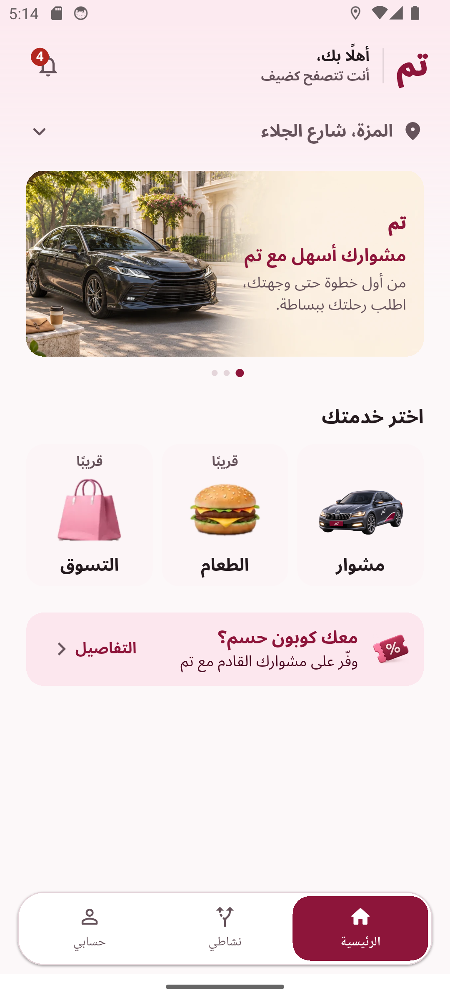

# AUI-01 — الرئيسية المرجعية

الفرع ahmad-ui، أساس1c0c831؛ main بقي746eb17 دون تغيير. دورroot: مشرف/منفذ، لا مراجعة مستقلة بعد. التنفيذ نسخة أولى قابلة للتجربة؛ لا شهادة إصدار أو اكتمالG3.

## النتيجة

HomeMasthead الحالي محفوظ كما هو، وتحته سطر عنوان المنزل المحفوظ أو أول عنوان عند غيابه. العنوان صادر من AddressesRepository الحالي عبر AddressesCubit، ويتحدث مع تغير دفتر العناوين؛ الضغط يفتح إدارة العناوين. لا حقل backend جديد لتفضيل افتراضي، ولا ادعاء GPS حي، ولا تغيير تلقائي لانطلاق الرحلة. المزود مربوط بالجلسة ويُغلق اشتراكه معها.

تدرج وردي من أعلى الشاشة إلى الخلفية، وشريط الحالة يطابق لون بدايته مع أيقونات داكنة. بانر بصورته الجديدة والنص المترجم الأصلي من HomeRepository، مع استمرار السحب والتقدم الآلي واحترام تقليل الحركة. الخدمات ثلاث: مشوار، طعام، تسوق؛ المشوار وحده ينقل للحجز، والآخران قريبًا. استُخدمت سيارةcomfort التي تحمل TAM منالأصلالموجود assets/maps/vehicle-comfort-user.png؛ وأيقونات الطعام والتسوق والحسم الحالية.

شريط الكوبون يشرح الحقل الموجود في الحجز، ولا يفعل عرض20% وهميًا ولا يستحدث عملية مالية. البيانات في الوضع الحالي mock، وAPIلا يسقط إلىmock. حالات التحميل/الفراغ/الخطأ وإعادة المحاولة باقية. لم تتغير Domain/Data/Auth/guest/localAccess أو عقود API. الروتر تغير فقط لتمرير مستودع العناوين الحالي.

## التحقق الفعلي

-24اختبارًا مستهدفًا نجحت فيhome_page،home_promotion_carousel،home_redesign،home_asset_budget؛ تغطي التنقل وخدمة غير متاحة وحالات التحميل/API/انقطاع الاتصال والسحب والـtimer وتقليل الحركة و320/390/800dp وRTL/LTR وخط2x. هذا الفحص بعد إضافة العنوان والتدرج وقبل تعديل شريط النظام وصورة السيارة الأخيرين.
- التحليل المستهدف لـhomeوapp_router:No issues found قبل تعديل شريط النظام/الأيقونة. التحليل العام الأول46ملاحظة، بينها importواحد أُزيل؛ الباقي فيأجزاء موجودة مسبقًا. لم تُعد الحزمة الكاملة أوgoldens القديمة ولا فحص كل الرحلات التطبيقية.
- ظهر overflowبشريطالكوبون على320dp/x2 فيالمحاولةالأولى؛ صُحح بتخطيطمرن ونجحت الحالاتبعده. لا تخفيض أو قفللتكبيرالنص.
- تنسيق الملفات المتغيرة مكتمل، build/debugAndroidx64 وتثبيت وتشغيل فعلي ناجحان. تأكد العرض بعدHotReloadثم أُعيد البناء والتثبيت للنسخة النهائية لتبقى التعديلات بعد إغلاق التطبيق. لقطةAndroid الحالية مرفقة.
- AppBar الحالي ونص الجلسة وزرالإشعارات وشريطالتنقل لم تُستبدل؛mainلم يُدمجبه التصميمالبديل، ولميُنفذpushأوCI.

## أصل البانر

Generated with built-in image_gen (imagegen skill)، ثم تحويلWebPمحليًا للتسليم. الملف النهائي:
/home/hazem/projects/tam-ahmad-ui/apps/customer/assets/images/ahmad_ui/home_hero.webp

الصورةالأصلية مولدة وليست لقطة من تطبيق ولا صورة سيارة تشغيل حقيقية. النص داخل Flutter؛ لا كتابة مخبوزة داخل الأصل. سُجّل المسار فيpubspec.

