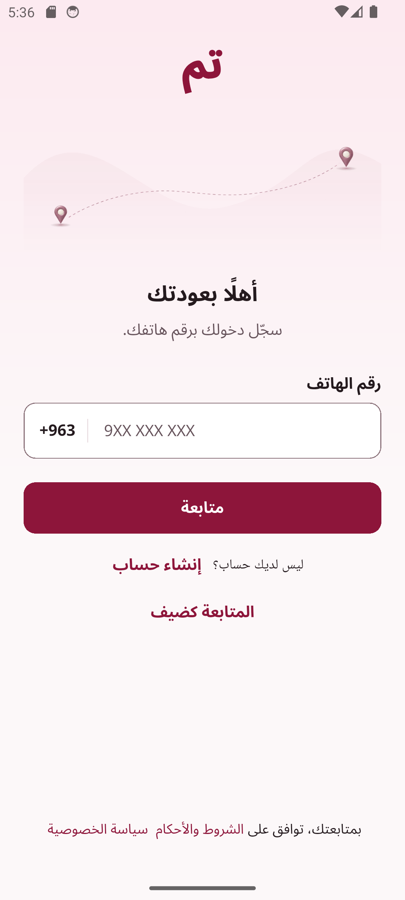
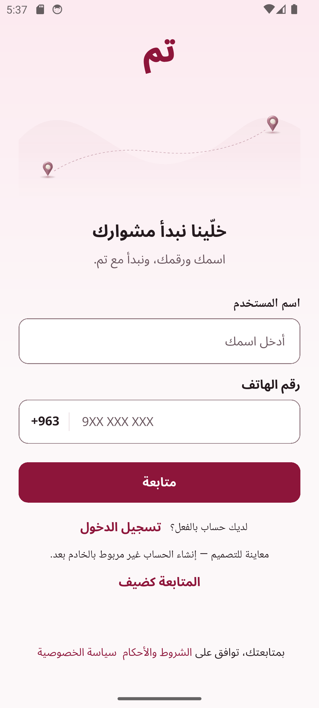
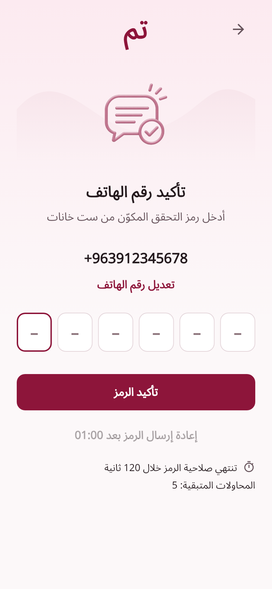

# AUI-02 — الدخول وإنشاء الحساب وOTP

الفرعahmad-ui، أساسe06b2ff. mainبقي746eb17. rootمشرف/منفذ؛ قيدمراجعةالمستخدم، لا مراجعةمستقلةأوجاهزيةإصدار.

## ما نُفذ

واجهةالدخول المطابقةللهرميةالمرجعية، وشاشةإنشاءحسابيمكنالتبديلإليها، وصفحةOTPبستخانات وقراءةLTRللرقم والرمز. العلامةتم، تدرجوردييصللشريطالنظام، زخرفةموجيةناعمة، رسمتاالمسارورسالةالتحققمولّدتانبخلفيةشفافة. عناصرالتحكممنالثيمالمركزي معخطTamSansالموجود، والروابطتفتحالشروطوالخصوصيةعبرالمساراتالعامةالموجودة. اختيارالضيفباقٍ.

إنشاءالحساببالاسم**معاينةتصميمفقط**:الاسموالهاتفيُتحققمنهما محليًا، وتظهررسالةواضحةبأنالربطغيرموجود. لا حفظاسم وهمي ولا إنشاءمستخدم أوجلسة. عقدAuthالحالييملكطلبالهاتف/OTP ولايملكهذهالعملية؛ سؤالالمستخدمعننطاقالربطمعلّق. التبديلبينالنموذجينيحافظعلىالهاتفويمسحرسالةالمعاينةعندالخروجمنها.

لميتغيرAuthCubitأوDomain/DataأوعقدAuthAPIأوالحمايةأوTEMPORARY_PHONE_ENTRY. بالتاليالإعدادالحاليللدخولالمؤقتمستمر،ولايفرضإرسالOTPبالخلفية. تصميمOTPمطبّقعلىصفحتهالحاليةومختبرعبرمستودعFakeتحتاختباراتالمشروعفقط؛ لاSMSحقيقيولامحاكاةتسجيلحقيقيداخلإصدارةالتطبيق. عناصرالشخصيةRiveالسابقةباقيةكأصول/مكوناتمستقلةولمتُحذفمنmain؛ تصميمAhmadUIيستخدمالمرجعالجديدفيهذهالواجهات.

## التحقق

45اختبارًافياuth_reference_preview/auth_flow/temporary_phone_entry/auth_inputsنجحت، و6اختباراتالهيكلالمرئيبعدتكييفها للمرجعالجديدنجحت:المجموع51. تشملالهاتفبصيغاتهولصقه،OTPخاطئ/تصحيح/إعادةالإرسالوالتوقيتوالانتهاء،الجلساتوالضيفوالدخولالمؤقتوالكيبوردوأحجام320/هاتف/أفقي،والتحققمنأنمعاينةإنشاءالحسابلاتنتجcredentialsأوchallengeأوجلسة. عُدّلت توقعاتاختبارالهاتفعلىالرئيسيةلتعكسخصوصيةالتصميمالمعتمد، معإبقاءتأكيداتحالةlocalAccessالمحليةدونمستخدمموثق.

التحليلالمستهدفauth/presentationوالثيمواختبارالمعاينة:Noissuesfound. تنسيقالملفاتالمتغيرةمكتمل. بناءAndroiddebugx64وتثبيتهوتشغيلهالنهائيناجحة. صورتاالدخول/التسجيلأدناهلقطاتAndroidفعلية،وصورةOTP**رسمWidgetاختباري**بمستودعFakeوليسترسالةتحققمرسلة. لمتُشغّلالحزمةالعامةأوCIولم يُنفذpushأودمجmain.

## الأصول المولدة

بواسطةbuilt-inimage_genبمهارةimagegen،معالحفاظعلىالشفافيةوالتحويلإلىWebP:

- /home/hazem/projects/tam-ahmad-ui/apps/customer/assets/images/ahmad_ui/auth_route.webp
- /home/hazem/projects/tam-ahmad-ui/apps/customer/assets/images/ahmad_ui/auth_otp.webp

نصاالتوليدفيIMAGE_PROMPTS.txt. لاكتابةأوعلامةمخبوزةفيالأصول؛ كلمةتم مرسومةبالخطالحقيقيداخلFlutter.

