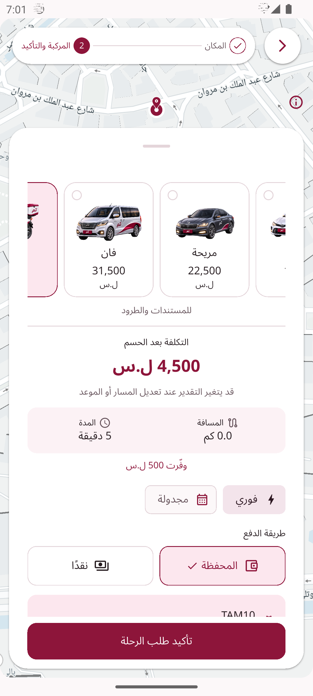
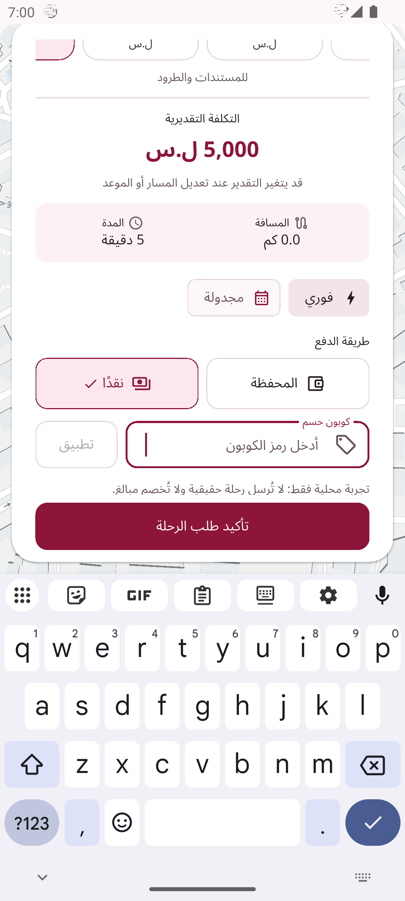

# تسليم اختيار المركبة والتكلفة — 2026-11-17

نُفّذ التصميم في الفرع `codex/ride-vehicle-fare-20261117`، أساس `cb4e2e3` الذي يجمع main المحلي795f999 وorigin/main4bf964f. لم يُدمج هذا التعديل في main ولم يُرفع بعد. النطاق محصور في ride_request والترجمة وحقول الدفع/الكوبون المشتركة الاختيارية؛ لا استبدال لشاشات بقية العملاء أو سلوك Auth.

## النتيجة

- مرحلتان: اختيار المكان ثم اختيار المركبة والتأكيد مع التكلفة، دون صفحة مراجعة مكررة.
- بطاقات مركبات أفقية قابلة للتمرير، وأسعار مقارنة صادرة من repository، وعدّ رقمي صاعد/نازل600ms يحترم تقليل الحركة.
- نقد/محفظة، وحقل كوبون ظاهر مع تطبيق/إزالة وأخطاء، وعرض الحسم والسعر النهائي والمسافة والمدة.
- الحفاظ على الجدولة الحالية عبر حوارها، وفحص صلاحية العرض والموقع ومفاتيح التأكيد ومنع الحجز المكرر. تعديلات النية تلغي العرض القديم؛ نتائج الطلب المتأخرة لا تستبدل النية الأحدث.
- ثيم Tam المركزي النهاري، RTL/LTR وتخطيطات شاشة صغيرة/تابلت/خط كبير/لوحة مفاتيح. زر التأكيد ثابت عندما تسمح المساحة ويصبح قابلاً للتمرير عند ضيقها.

## الوضع الفعلي

الدفع والكوبون محاكاة تطوير فقط: TAM10 يحسم10% في بيانات mock. لا خصم أموال ولا رصيد محفظة حقيقي ولا إرسال حجز حقيقي. API mode يبقى SERVICE_UNAVAILABLE دون نجاح وهمي. عقدv2 وأمثلة Postman والبيانات المطابقة في docs/api/ride_request؛ لم تُنفَّذ طلبات Postman على backend. المراجعة البصرية النهائية ضمن المرحلة الثانية، وليست هذه شهادة جاهزية إصدار.

## التحقق

- dart format:483 ملفًا، صفر تغييرات.
- flutter analyze --no-pub:42info موجودة مسبقًا؛ لا أخطاء أو تحذيرات جديدة.
- الحزمة الكاملة:831نجاحًا/27إخفاقًا؛ جميع أسماء الإخفاقات موجودة في فحص main السابق، دون أسماء إخفاقات جديدة. خمسة إخفاقات سابقة زالت. منها إخفاقات قديمة لاختيار المكان بالعربية وgoldens للرحلات وpumpAndSettle للرحلة النشطة؛ لا ندّعي نجاح الحزمة كاملة.
- بعد إعادة استهلاك AppTheme.rideJourney الحالي:8اختبارات الواجهة/الحركة نجحت، بما فيها320dp وخط2x والكيبورد والتابلت والوضع الأفقي. فحص الحزمة الكاملة سبق هذا الاسترجاع الصغير ولم يُكرر بعدها.
- فحص تنقل الحجز والجدولة:10نجاحات. اختبارات المجال والعقد الجديدة تتحقق من تغير الدفع/الكوبون، سباق النتائج، إعادة المحاولة بعد فقد الاستجابة، توافقv1، صحةdiscount وعدم تحويل API إلىmock.
- بناء Android debug x64 ناجح، تثبيت وتشغيل على emulator-5554 ناجحان. تجربة فعلية للمحفظة وTAM10 وتغير السعر؛ الصور أدناه من التطبيق نفسه. تعثرت محاولة البناء الأولى لامتلاء القرص ثم نجحت بعد حذف intermediates مؤقتة فقط.
- صور اختبارات widgets لم تُعتمد بصريًا لظهور خط Ahem؛ أُزيلت من التسليم واستُبدلت بلقطات Android المقروءة.

## ملاحظات الصيانة

RideDraftBloc يتجاوز300سطر لأن دورة quote/expiry/idempotency متماسكة وموجودة أصلًا؛ فُصل تحميل مقارنة العروض إلى usecase مستقل وفُصلت عناصر الواجهة إلى ملفات مركزة. لم تُضف حزم. لا دمج أوpush تلقائي.

